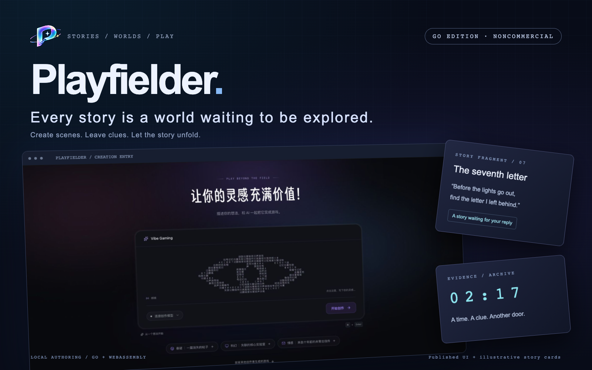
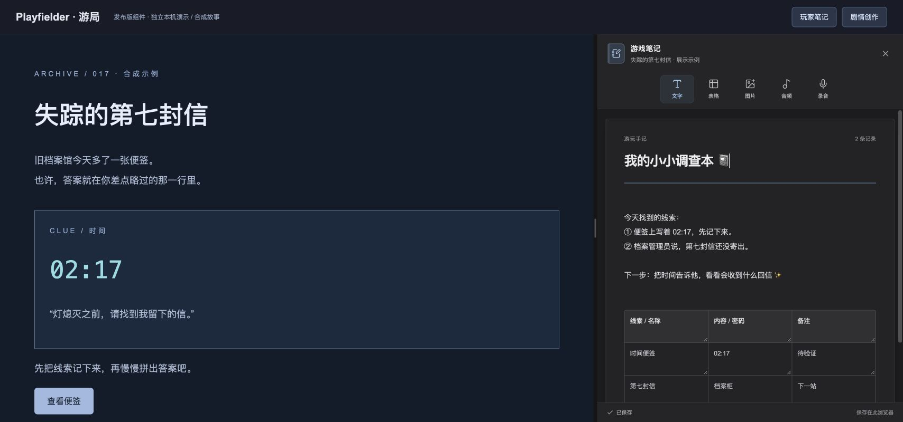
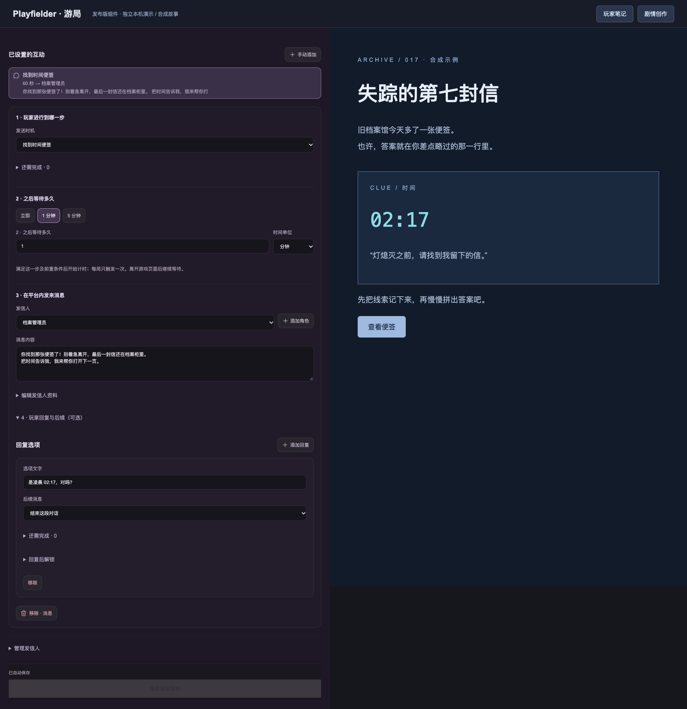
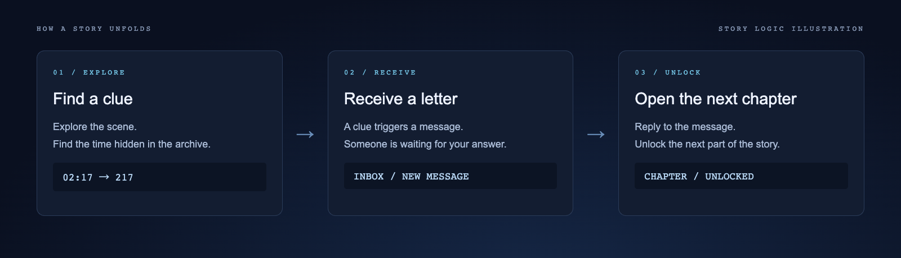

# Playfielder



**Bring your curiosity. The next page is waiting for you. ✨**

Some stories hide in a late letter. Some clues live in a corner of a web page you almost missed. Playfielder helps turn those little “wait, what?” moments into worlds you can explore, respond to and play.

Come as a player: collect clues, keep notes and piece things together. Or become a creator: build scenes, arrange character messages and give someone else a story to discover.

**This is an independent, local Go authoring edition.** Create, play and export games on your own computer. The notebook and story-editor captures below are local component demonstrations; player notebooks have not yet been ported to Go and are labeled accordingly.

[Run Go locally](#run-locally) · [Player notebooks](#players-bring-your-little-detective-notebook-) · [Creation tools](#creators-give-your-idea-a-world-) · [Local edition](#create-and-play-on-your-own-computer) · [中文](README.md)

> **Noncommercial use only.** This repository uses PolyForm Noncommercial 1.0.0. Personal noncommercial creation is welcome within its terms. Paid game sales and commercial production by studios or organizations require separate authorization. See the [license details](#license-source-available-for-noncommercial-purposes).

## Players: bring your little detective notebook 📓

Too many passwords? A tangle of names? Jot them down. Detectives are allowed a cheat sheet.



*Local capture of the existing published-edition notebook component, with a synthetic story and notes in a standalone demo shell. This is not a Go-edition UI capture.*

- **Write it down:** passwords, suspicious dates and a little reminder of what to investigate next.
- **Make a table:** organize characters, clues and theories waiting to be checked.
- **Keep images and audio:** upload or drop attachments, paste screenshots, enlarge images and download attachments.
- **Say your thought out loud:** microphone recording captures your own reasoning, not game or system audio.
- **Play and write side by side:** resize the desktop split; narrow screens stack the panels. Restarting a game keeps its notebook.

Each game has its own notebook in the current browser. Notes are not sent to AI or synced to other devices. Clearing site data clears them too, so keep separate copies of important attachments.

## Creators: give your idea a world ✨

“A late-night archive. A letter with no sender.” A small beginning can be enough to start exploring an idea.



*Local capture of the existing published-edition story editor with synthetic characters and content. Go also supports characters, messages, triggers and reply unlocks; its interface differs.*

| What you want to do | How to start |
| --- | --- |
| Give your scene a personality | Edit text, images and web source to create an entrance that fits your story |
| Make a character feel present | Set the sender, message and delay so a letter follows the player’s exploration |
| Give replies consequences | Configure reply choices and unlock conditions to open the next part of the story |
| Return to an earlier idea | Use autosave, undo/redo, snapshots and restores |
| Take your story with you | Export editable project packages or offline playable pages |
| Invite a creative assistant | Optionally connect a model service; manual editing, play and export work without one |

## A clue can be the key to the next page



*Story-mechanic illustration, not a recording. Authors configure clues, triggers, character messages and reply choices.*

Explore a scene and find a time written on a note. A clue triggers a letter; a reply unlocks more content. Leave a little room for the player to discover things themselves.

## Create and play on your own computer

| Local feature | Current support |
| --- | --- |
| Create games | Web scenes, character messages, triggers, replies and content unlocks |
| Play games | Browser play, saved progress and restart, read-only play links on the current computer |
| Save and take your work with you | Independent data, version restores, project import/export and offline pages |
| Optional creative assistant | Chat / Responses protocols; manual creation works without a model, and real-model creative quality still needs checking |

The server, persistence, generation tasks and story rules use Go. The browser UI uses HTML, CSS and JavaScript; exported story rules run through Go WebAssembly. Independent local data keeps this edition separate from the existing published service.

Ready to make a little world? Start with the local setup below. Questions and ideas are welcome in [Issues](https://github.com/Azhe-ZJ/Playfielder/issues).

## License: source available for noncommercial purposes

Copyright 2026 Azhe-ZJ. Project-authored code is licensed under [PolyForm Noncommercial 1.0.0](LICENSE).

Personal study, research, entertainment and noncommercial game creation are permitted within the license terms, as are permitted modifications and redistribution. This license does not authorize individuals to create games for paid sale, or commercial production, paid services or tool resale by studios or organizations. Commercial use requires separate authorization from the copyright holder. The standard license expressly permits specified educational, charitable and other noncommercial organizations.

Authors retain the rights they hold in original stories and assets. This software license does not automatically relicense their creative content. Exported Playfielder runtime code remains subject to the software license and retains its notices. Third-party dependencies retain their own licenses; see [notices](THIRD_PARTY_NOTICES.md).

## Features

Create projects from an investigation example or blank story; edit text and images in an isolated preview or edit source directly; configure characters, triggered and delayed messages, reply choices and unlock effects. Autosave, undo/redo, snapshots and restores preserve authoring history. Browser play progress survives preview refreshes.

Import JSON, HTML or this edition’s ZIP packages and export editable packages with offline playable pages. Optionally connect a model service supporting Chat Completions or Responses, inspect streamed task progress, cancel tasks and explicitly resume interrupted work. Read-only preview links are local to the current computer.

## Run locally

Install Go 1.27 or newer and use a modern browser with WebAssembly support.

```sh
go build -trimpath -o bin/playfielder ./cmd/playfielder
./bin/playfielder --addr 127.0.0.1:4177 --data ./data
```

Open http://127.0.0.1:4177. On Windows, use a `.exe` output name. Only loopback addresses are accepted. Use an independent data directory and stop the application before backing it up. Manual editing and export work without a configured model.

## Optional model connection

```sh
export PLAYFIELDER_MODEL_BASE_URL=https://your-provider.example/v1
export PLAYFIELDER_MODEL_API_KEY=your-key
export PLAYFIELDER_MODEL=your-model
export PLAYFIELDER_MODEL_MODE=chat
./bin/playfielder --addr 127.0.0.1:4177 --data ./data
```

Mode is `chat` (default) or `responses`. Keys are read from server-side environment variables and are not exported with projects or sent to the browser. The configured provider receives the authoring request and current project content, and may charge for calls. HTTPS is required except for loopback HTTP.

One active task per project; at most two calls per run, four total calls per task and two explicit resumes. After restart, tasks are interrupted and require manual resumption. Canceled or interrupted tasks and revision conflicts cannot commit a new project version. Usage records are informational, not provider billing or a monetary spending cap.

## Project exchange

ZIP exports contain `manifest.json`, assets, an offline `index.html` and runtime notices. Assets and story runtime are embedded; the authoring server is not required to play. External network resources, remote fonts and embedded third-party pages are unsupported.

Legacy JSON import extracts source, story and the current version; it does not migrate accounts, model settings, production history or online links. Complex legacy games may need adjustment. Validate a copy first.

## Development

```sh
make test
make browser-test
make wasm
make build
```

Browser acceptance requires Chrome/Chromium or `PLAYFIELDER_CHROME`; tests use a new browser profile and temporary data. `make wasm` rebuilds the shared story engine and copies `wasm_exec.js` from the same Go toolchain. The checked-in Wasm was built with Go 1.27.2. Update the paired runtime and Go license notice when changing toolchains. `make notices` synchronizes approved project licensing notices into exported runtime resources.

`internal/store` owns transactions and versions; `internal/story` is the pure Go state machine; `internal/agent` owns model protocols and task lifecycle; `internal/document` builds isolated playable documents; `internal/packageio` owns project exchange; `internal/httpapi` serves local endpoints. `web` needs no Node build.

## Current scope

This is a local, single-author edition. It does not provide multiuser accounts, a community, payments, hosted deployment or public-network access controls. Do not expose it directly as a public server. Validation covers transactions, story rules, project exchange, mocked model protocols and browser editing/playthrough. Actual model output quality requires separate evaluation.
