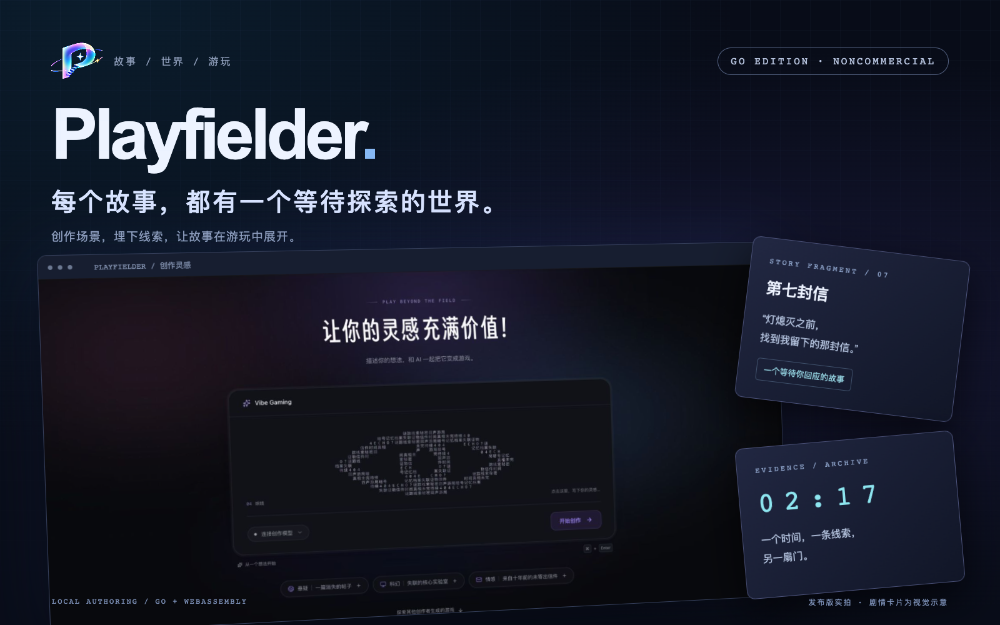
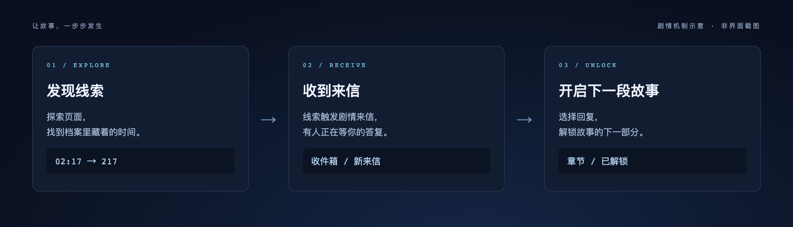

# Playfielder · 游局



**带上好奇心，故事的下一页等你来打开。✨**

有些故事，藏在一封迟到的信里；有些线索，躲在你差点略过的网页角落。Playfielder 想把这些小小的“咦？”变成可以探索、回应和游玩的世界。

你可以当玩家，找线索、记笔记、慢慢拼出答案；也可以当创作者，写场景、安排角色来信，把脑洞做成别人能亲手探索的故事。

**这是独立的本机 Go 创作版。** 在自己的电脑上做游戏、试玩和导出作品。下方的笔记与剧情编辑实拍来自本机组件演示；游戏笔记尚未移植到 Go 版，已明确标注。

[启动 Go 版](#本机启动) · [玩家的小侦探本](#玩家带上你的小侦探本-) · [创作功能](#创作者把脑洞做成一个世界-) · [本地版范围](#在自己的电脑上做游戏和玩游戏) · [English](README.en.md)

> **仅限非商业用途。** 本仓库采用 PolyForm Noncommercial 1.0.0。欢迎个人非商业创作；收费出售游戏、机构或工作室的商业生产须另行取得授权。详细条款见[授权说明](#授权源码公开仅限非商业用途)。

## 玩家：带上你的小侦探本 📓

密码太多记不住？人物关系越看越绕？先记下来，侦探也可以有小抄。


*发布版原有笔记组件的本机实拍。故事和笔记均为合成展示内容，外层页面为独立演示容器；不是 Go 版功能截图。*

- **文字随手记**：收集密码、可疑日期，还有“下次回来先查这里”的小提醒。
- **表格理一理**：把人物、线索和待验证的猜测放到一起，乱糟糟的思路也能慢慢排好队。
- **图片与音频放进本子**：上传或拖入附件，也能粘贴截图；图片可以放大查看，附件可以下载。
- **想法来得太快？说下来**：支持麦克风录音，记录自己的推理。它录的是麦克风声音，不是游戏或系统声音。
- **一边玩，一边记**：桌面上可调整游戏与笔记的宽度，窄屏上上下排列；重开游戏不会清掉笔记。

笔记保存在当前浏览器里，每款游戏各有一本，不会发给 AI，也不会同步到其他设备。清理网站数据会清掉笔记，重要附件记得另外留一份。

## 创作者：把脑洞做成一个世界 ✨

“一座半夜还亮着灯的档案馆，一封没有寄件人的信。”有这样一个开头，就可以继续往下想了。


*发布版原有剧情编辑组件的本机实拍，使用合成角色和故事。Go 版也支持角色、来信、触发条件和回复解锁；具体界面以 Go 版为准。*

| 你想做的事 | 可以怎么做 |
| --- | --- |
| 让场景有自己的样子 | 编辑文字、图片和网页代码，给故事安排一个合适的入口 |
| 让角色像真的在等你 | 设置发信人、消息内容和等待时间，让来信跟着玩家的探索出现 |
| 让回复有分量 | 配置回复选项与解锁条件，让一个选择打开下一段故事 |
| 改错了，还想回到刚才 | 自动保存、撤销重做、保存版本，再恢复到想继续的那一版 |
| 带作品出去玩 | 导出可继续编辑的作品包，或可以离线运行的页面 |
| 找个助手一起想 | 可选连接模型服务辅助创作；不配置模型也能手动编辑、试玩和导出 |

## 一条线索，可能就是下一页的钥匙



*剧情机制示意，不是录屏。线索、触发条件、角色来信和回复选项都由创作者安排。*

玩家探索页面，找到时间便签；线索触发一封来信，再通过回复解锁新的内容。故事不必一口气讲完，可以给玩家留一点自己发现的快乐。

## 在自己的电脑上，做游戏和玩游戏

| 本地功能 | 当前支持 |
| --- | --- |
| 做游戏 | 网页场景编辑、角色来信、触发条件、回复与内容解锁 |
| 玩游戏 | 浏览器试玩、进度保存与重开、只在当前电脑打开的只读试玩链接 |
| 保存与带走作品 | 独立数据目录、历史版本恢复、作品包导入导出、离线页面 |
| 可选创作助手 | Chat / Responses 协议；不配置模型也能手动创作，真实模型创作质量仍需核对 |

Go 版的服务器、存储、创作任务和剧情规则使用 Go；浏览器界面使用 HTML、CSS、JavaScript，导出的剧情规则运行在 Go WebAssembly 中。它有独立的本机数据目录，启动、导入和试玩都不会连接现有发布版。

想亲手做一个小世界？从下面的本机启动开始吧。遇到问题或有新点子，也欢迎在 [Issues](https://github.com/Azhe-ZJ/Playfielder/issues) 里留下来。

## 授权：源码公开，仅限非商业用途

Copyright 2026 Azhe-ZJ。项目自有代码采用 [PolyForm Noncommercial 1.0.0](LICENSE)。这是附带非商业限制的源码可用项目。

- 允许个人学习、研究、自娱和非商业游戏创作，在许可范围内修改、分享代码。
- 不授权个人用本工具制作并收费出售游戏，也不授权机构、工作室将其用于商业生产、收费服务或工具销售。商业用途须另行获得版权方授权。
- 标准条款明确许可的教育、慈善、公共研究等机构用途，按许可证原文执行。
- 用户原创故事、图片等素材的版权属于各自权利人。工具许可证不自动改变这些内容的版权；导出作品包含的 Playfielder 运行时代码仍受本许可证限制，导出时保留授权告知。
- 第三方依赖保持各自许可证，见 [第三方告知](THIRD_PARTY_NOTICES.md)。

## 可以做什么

- 建立作品库，从调查档案示例或空白故事开始。
- 在隔离预览中点击文字、替换图片，或直接编辑 HTML、CSS、JavaScript。
- 创建角色和剧情来信，配置事件触发、延迟、回复选项和内容解锁。
- 自动保存、撤销重做、保存版本、恢复历史版本；试玩进度保存在当前浏览器。
- 导入作品 JSON、HTML 或本版 ZIP；导出可继续编辑的作品包和离线运行页面。
- 选择性连接支持 Chat Completions 或 Responses 协议的模型服务，流式查看生成状态、取消任务、显式恢复中断任务。
- 生成只在当前电脑可访问的只读试玩链接。

## 本机启动

安装 Go 1.27 或更新版本。浏览器建议使用支持 WebAssembly 的现代浏览器。

```sh
go build -trimpath -o bin/playfielder ./cmd/playfielder
./bin/playfielder --addr 127.0.0.1:4177 --data ./data
```

打开 http://127.0.0.1:4177。Windows 编译时可将输出名改为 `playfielder.exe`。服务只接受回环地址；请使用独立数据目录，备份前停止程序。无模型配置也可手动创作、试玩和导出。

## 可选模型连接

```sh
export PLAYFIELDER_MODEL_BASE_URL=https://your-provider.example/v1
export PLAYFIELDER_MODEL_API_KEY=your-key
export PLAYFIELDER_MODEL=your-model
export PLAYFIELDER_MODEL_MODE=chat
./bin/playfielder --addr 127.0.0.1:4177 --data ./data
```

`PLAYFIELDER_MODEL_MODE` 可选 `chat` 或 `responses`，默认 `chat`。密钥仅从服务端环境读取，不放进作品、导出包或浏览器。模型会收到创作请求和当前作品内容；调用费用按服务商计费。基础地址要求 HTTPS，或本机回环 HTTP。

每个作品同时最多运行一个任务，每次运行最多两次模型调用，总计最多四次；恢复次数最多两次。重启后任务标记为中断，须手动恢复。取消、中断或版本冲突均不会提交新作品版本。用量记录用于查看调用情况，不是服务商账单或金额上限。

## 导入与导出

ZIP 中包含 `manifest.json`、素材、`index.html` 和运行时授权告知。导出的页面内嵌素材及剧情运行时，无需创作服务器。无外网请求支持，不允许第三方脚本、远程字体或嵌入页面。

旧版 JSON 支持提取作品代码、剧情和当前版本，不迁移账号、模型配置、原服务历史数据或线上地址。旧版复杂作品可能需要调整，请先用副本核对。

## 开发与验证

```sh
make test
make browser-test
```

浏览器验收需要本机 Chrome/Chromium，或设置 `PLAYFIELDER_CHROME` 指向可执行文件；测试使用全新浏览器配置和临时数据。

重新编译剧情运行时：

```sh
make wasm
make build
```

`make wasm` 同步同一 Go 工具链的 `wasm_exec.js`。仓库预置的 Wasm 使用 Go 1.27.2 构建。更换工具链时须一起更新运行时与 Go 许可证告知。`make notices` 同步获批准的项目许可证及版权告知到导出运行时。

目录分工：`internal/store` 负责事务和版本；`internal/story` 是纯 Go 剧情状态机；`internal/agent` 管理模型协议与任务生命周期；`internal/document` 生成隔离作品页面；`internal/packageio` 管理包交换；`internal/httpapi` 提供本机接口；`web` 为无需 Node 构建的浏览器界面。

## 当前范围

这是本机单作者版本。尚未提供多人账号、社区、支付、线上部署与公网访问控制。不要直接将它作为公网服务器使用。当前自动验证涵盖事务、规则、导入导出、模型协议模拟，以及浏览器编辑与试玩；真实模型创作质量仍需实际核对。
